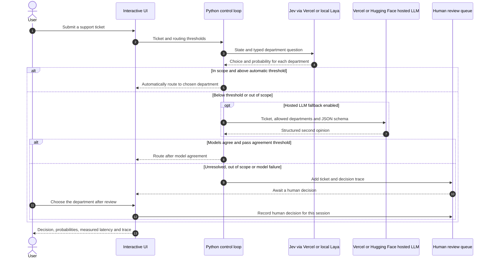
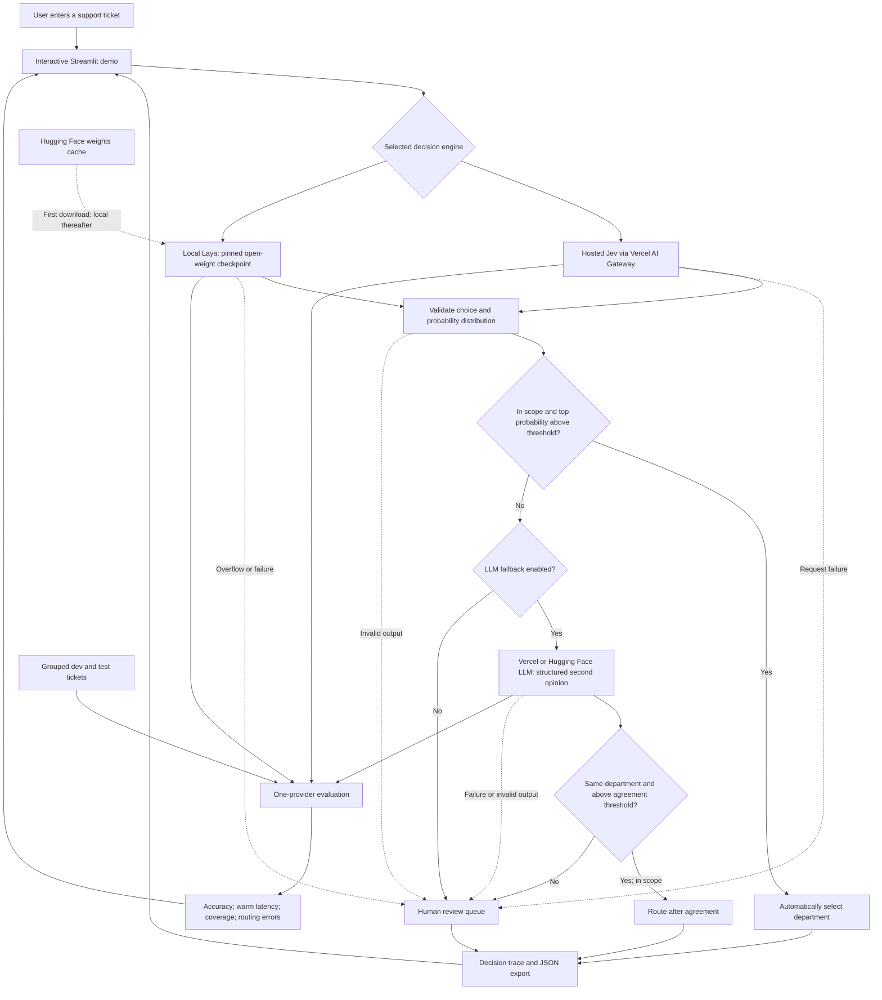

# Decision Router Lab

**When should a decision model act, and when should it ask for help?**

A support-ticket routing experiment using hosted [Jev through Vercel](https://vercel.com/ai-gateway/models/jev)
or local [Laya](https://github.com/NandhaKishorM/laya).
It selects a department, applies an explicit probability threshold, optionally asks
an LLM for a second opinion, and queues unresolved cases for human review.

The application and synthetic dataset are MIT licensed. Laya is an independent,
Apache-2.0 open-weight model; it is not TypeSafe's Jev. Jev runs remotely through
Vercel AI Gateway. Local Laya weights stay in the Hugging Face cache and are not committed.

## Architecture

### Request sequence



This follows the sequence-diagram style of an agent control loop. In this version,
the bounded decision is department selection; external tools, ontology storage,
calendar execution and a general task-planning agent are not implemented.

### Components



The model produces a distribution; Python code owns the routing policy. The optional
simulation substitutes labeled keyword rules for the decision model. The review queue is a local
demo. Individual-provider benchmarks do not measure the combined cascade.
See [the detailed diagrams](docs/architecture.md) for the evaluation workflow.

## Start the demo

Use Python 3.10 or newer (the project was tested with 3.11). No API key is needed
for simulation or local Laya inference.

```bash
cd /path/to/decision-router
python3.11 -m venv .venv
.venv/bin/python -m pip install -e '.[laya,ui,dev]'
.venv/bin/streamlit run app.py --server.address 127.0.0.1
```

Open `http://localhost:8501`. The UI starts with **Jev · hosted via Vercel** and needs
an AI Gateway key. Select **Mock rules · no AI model** to try the interface immediately,
or **Laya · live local model** to run the local model. Simulation is deterministic keyword matching
with invented probability scores, labeled throughout the application and exports.
It must not be used as model evidence.

Laya's first run downloads one checkpoint (roughly 1–2 GB) and builds the encoder.
Later inference is local. CPU is the default; select `mps` for Apple Silicon or
`cuda` for an NVIDIA GPU with a compatible PyTorch installation. This project's
smoke dataset is English; use the multilingual checkpoint for other languages and
evaluate those languages separately.

## Route a ticket

```bash
.venv/bin/decision-router route --provider laya --device mps \
  --text 'We were charged twice. Please refund the duplicate payment.'

# Test the policy without downloading weights:
.venv/bin/decision-router route --provider simulation \
  --text 'I have an invoice question and an API error.'
```

Five outcomes: `billing`, `technical`, `account`, `sales`, and `other`.
The default checkpoint is explicitly `typed-decisions`. It was fine-tuned by Laya's
authors on four synthetic workflows, including customer service; it has not been
fine-tuned on this project's dataset. Base checkpoints and this checkpoint can
perform very differently. `--checkpoint english` and `--checkpoint multilingual`
allow controlled comparisons.

Policy uses the selected label's probability, **not the model's separate confidence statistic**:

1. A non-`other` decision at or above `--threshold` routes automatically (default 0.85).
2. Otherwise, with `--llm-fallback`, ask the configured LLM. If it agrees on a
   non-`other` label and the primary probability is at least `--agreement-threshold`
   (default 0.60), route after agreement.
3. All other cases, including inference failures, go to human review.

These defaults are starting settings, not calibrated operating guarantees.
Two models agreeing does not prove correctness: test the agreement policy separately
before automating with it. `other` always requires review. The UI review queue is
session-local; it does not send messages, create real support tickets or persist a database.
Oversized inputs are rejected rather than silently truncated by the Laya SDK.

## Hosted Jev through Vercel

No decision-model download is required. For a hosted-only installation:

```bash
.venv/bin/python -m pip install -e '.[ui,dev]'
```

1. In the Vercel dashboard, choose **Create** beside **AI Gateway Key** and create a key.
2. Open this application's sidebar and select **Jev · hosted via Vercel**.
3. Enter the key in the masked **Vercel AI Gateway key** field under **Jev connection**.
4. Leave **LLM service** set to **Vercel AI Gateway** to reuse the key for Qwen 3 32B.
5. Submit a sample using **Route ticket**, or check **Include the configured LLM** and run **Live comparison**.

The session key is not written to files, exports, logs or Git, and is not held in a
shared resource cache. You may instead set `AI_GATEWAY_API_KEY` in the server environment.
The application sends ticket text to Vercel only when you run Jev. You need available
Gateway credits or billing. No project deployment or direct TypeSafe key is required.

The adapter calls `POST https://ai-gateway.vercel.sh/v1/evaluate` with model
`typesafe-ai/jev`, state and a typed department question. It validates the choice and
the full five-option probability distribution before applying the routing policy.
Hosted latency includes network time. **Run evaluation** makes 21 requests for a
bundled split, including warmup; both Jev and any LLM fallback consume their respective
provider credits. The comparison makes one Jev request and optionally one LLM request.

```bash
# Set AI_GATEWAY_API_KEY securely in your environment first.
.venv/bin/decision-router route --provider jev \
  --text 'We were charged twice. Please refund the duplicate payment.'
.venv/bin/decision-router benchmark --provider jev --split dev \
  --output results/jev-dev.json
```

Contract and UI tests use mocked responses and do not establish live account access
or Jev's accuracy. An authenticated smoke run still requires your Gateway key.
References: [Vercel evaluation API](https://vercel.com/docs/ai-gateway/modalities/evaluation),
[Gateway API keys](https://vercel.com/docs/ai-gateway/authentication-and-byok/api-keys).

## Hosted Vercel LLM baseline and fallback

The UI defaults to `alibaba/qwen-3-32b` through Vercel AI Gateway, using the same
masked Gateway key as Jev. No Hugging Face token, local LLM download or Vercel app
deployment is required. The LLM uses `/v1/chat/completions`; Jev uses the separate
`/v1/evaluate` API. Both consume Gateway credits when you run them.

Open **Hosted LLM connection**, leave **LLM service** on **Vercel AI Gateway**, and
check **Include the configured LLM** in **Live comparison**. Alternatively, enable
**Ask an LLM when uncertain** for routing. A custom Vercel model ID is supported;
choose a model/provider with JSON-schema structured-output support.

For CLI calls, configure the service explicitly (the CLI's default remains HF):

```bash
# Set AI_GATEWAY_API_KEY securely in your environment first.
export LLM_BASE_URL='https://ai-gateway.vercel.sh/v1'
export LLM_MODEL='alibaba/qwen-3-32b'
.venv/bin/decision-router route --provider jev --llm-fallback \
  --text 'I cannot access my account and need help with an invoice.'
```

Tests verify the API contract and that one session key serves both models. Live
authenticated requests and routing quality still need verification with your account.
References: [Qwen 3 32B on Vercel](https://vercel.com/ai-gateway/models/qwen-3-32b),
[Vercel's Python API guide](https://vercel.com/docs/ai-gateway/sdks-and-apis/python).

## Alternative: hosted Hugging Face LLM baseline and fallback

No LLM download is required. The default for the Hugging Face connection is
`Qwen/Qwen3.5-35B-A3B:deepinfra` via `https://router.huggingface.co/v1`.
The provider is explicit because structured-output support varies by provider.
The Hugging Face live model catalog listed this combination with structured-output
support when checked on October 3, 2026. `Qwen/Qwen3-32B:deepinfra` is an alternative.
Availability can change; neither model's ticket-routing quality has been measured
by this project yet.

In the UI, open **Hosted LLM connection**, select **Hugging Face**, choose the model, and enter a Hugging Face
token with **Make calls to Inference Providers** permission. The token stays in the
session and is not written to files, reports or Git. You need available inference
credits. Then use **Live comparison**, enable LLM fallback, or evaluate the LLM.
You can also provide `HF_TOKEN` in the server environment.

Laya is different: its model card currently lists no Inference Provider deployment.
It therefore runs locally in this project. Avoiding its initial download requires
a separately hosted Laya endpoint; this application does not provision one.

References: [Hugging Face structured outputs](https://huggingface.co/docs/inference-providers/guides/structured-output),
[hosted model catalog](https://huggingface.co/inference/models),
[Qwen model](https://huggingface.co/Qwen/Qwen3.5-35B-A3B).

The adapter uses an OpenAI-compatible chat endpoint and requires JSON-schema
structured outputs. Choose a model/provider that supports them. The endpoint sees
the ticket text when this option is enabled; local Laya inference does not send tickets
to a hosted inference service. Secrets are read from the shell, never from source files.

```bash
export LLM_BASE_URL='https://router.huggingface.co/v1'
export LLM_MODEL='Qwen/Qwen3.5-35B-A3B:deepinfra'
# Set HF_TOKEN securely in your shell.

.venv/bin/decision-router route --provider laya --llm-fallback \
  --text 'I cannot access my account and need help with an invoice.'

.venv/bin/decision-router benchmark --provider llm --split test \
  --output results/llm-test.json
```

The LLM returns only a label. We do not invent probability distributions or treat
self-reported confidence as calibrated evidence. Compare its classification accuracy
and latency with the selected decision model; standalone LLM probability and selective-routing metrics are
unavailable. Hosted cost depends on your chosen model; token usage is exported for
successful calls, and account billing remains the source of truth.

## Evaluate before publishing claims

```bash
# Explore on development data:
.venv/bin/decision-router benchmark --provider laya --split dev --device mps \
  --output results/laya-dev.json

# Freeze a threshold, then run the separate test split:
.venv/bin/decision-router benchmark --provider laya --split test --device mps \
  --threshold 0.90 --output results/laya-test.json

# CI / offline plumbing check:
.venv/bin/decision-router benchmark --provider simulation \
  --output results/simulation.json
```

Outputs include full predictions, a dataset hash, checkpoint SHA, model/package
identifier, warmup duration, classification accuracy, p50/p95 warm inference
latency, automation coverage, review rate, automatic routing error counts, and
accuracy among automatically routed tickets. Calibration diagnostics include a
multiclass Brier score (sum across all labels, range 0–2) and 10-bin expected
calibration error. Empty accepted sets have `null` selective accuracy, not 100%.
Failed requests count against overall accuracy and require review; latency covers
successful inference calls only.

The threshold sweep is an exploration of frozen predictions. It does not refit
probabilities, train Laya or select an operating threshold for you. The optional
LLM agreement cascade is available in routing, but **the benchmark measures one
provider at a time**; do not report its results as measured cascade performance.
The UI also includes a live comparison of your selected decision engine and configured LLM on the same
ticket, a movable threshold preview that reuses the actual probabilities, and a
session-local queue with manual review actions.

The 40 hand-authored tickets are a **synthetic smoke dataset**, not a representative
benchmark. See [data/README.md](data/README.md). Replace them with a larger labeled
set, split by conversation/customer, use development data for threshold selection
and any calibration, and retain an untouched test set. Include error examples and
the denominator behind every percentage in any public results.

Laya's own [model card](https://huggingface.co/convaiinnovations/laya#honest-limits)
reports weak base-checkpoint performance on typed workflows and overconfident
probabilities. Local execution and typed outputs do not establish decision quality.

## Reproducibility

- Laya SDK: `0.3.4` (the installable release used here).
- Default Hugging Face revision: `55cf4c4ebb4ebe31b2550e8bdf3bd21b99753851`.
- `--revision` accepts an immutable 40-character SHA to explicitly change it.
- `requirements-tested.txt` records the tested local environment. To reproduce:
  `.venv/bin/python -m pip install -r requirements-tested.txt`, then
  `.venv/bin/python -m pip install -e . --no-deps`.
- Only the selected checkpoint's five required files are downloaded. The adapter
  uses SDK sequence formatting to reject overflow; this is why its SDK is pinned.
- Downloaded weights can be reused with `HF_HUB_OFFLINE=1` after first setup.
- Hardware, model warmup and loading affect latency; record device details with
  any published report. Self-hosting still uses compute, energy and memory.

## Development

```bash
.venv/bin/pytest
.venv/bin/ruff check .
```

CI tests routing and failure handling, probability validation, benchmark metrics,
dataset split isolation, the hosted Jev contract and the structured LLM contract without downloading weights
or using paid APIs. A manual Laya smoke run checks the actual runtime separately.

## GitHub and the follow-up post

This directory is a standalone Git repository, separate from company code. Push
the application, documentation, dataset and tests; keep credentials, cached weights
and generated reports outside the commit unless you deliberately review a report
for publication. Reports contain ticket text.

See [docs/linkedin-draft.md](docs/linkedin-draft.md) for a post template to complete
after evaluation. Credit Laya and publish actual measurements with the limitations
of your dataset. Do not call this "open-source Jev" or claim it reproduces Jev's
private architecture or training.
