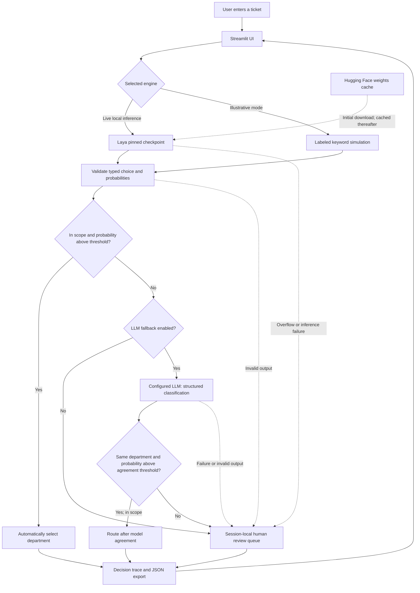
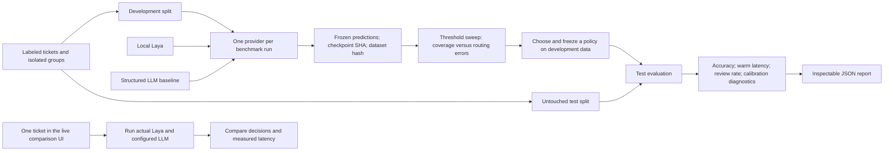

# Decision Router architecture

## Interactive routing

The model estimates a distribution; ordinary Python owns the action policy.
`other` is always out of scope for automatic routing. The fallback agreement rule
is an experimental policy, not a guarantee. The queue is a demonstration, not an
external support integration. Live Laya has no per-request inference API; the
optional hosted LLM receives the ticket when enabled.

## Evaluation and live comparison

Benchmark commands evaluate providers individually. The interactive comparison
measures one ticket; neither establishes combined cascade performance. Warm latency
excludes checkpoint loading and warmup, while reports preserve the warmup duration.
Laya's rounded probabilities are normalized only within their four-decimal rounding
tolerance; no domain calibration is fitted by the application.

